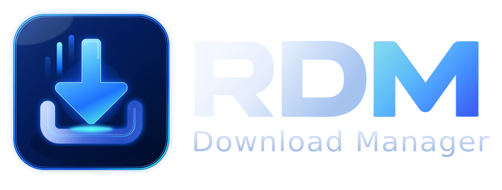
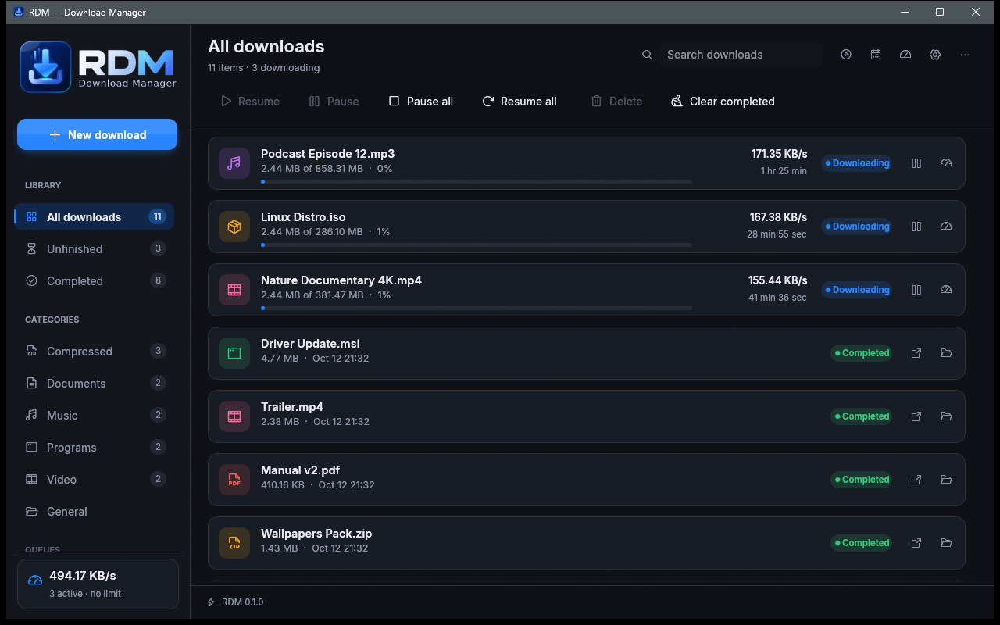
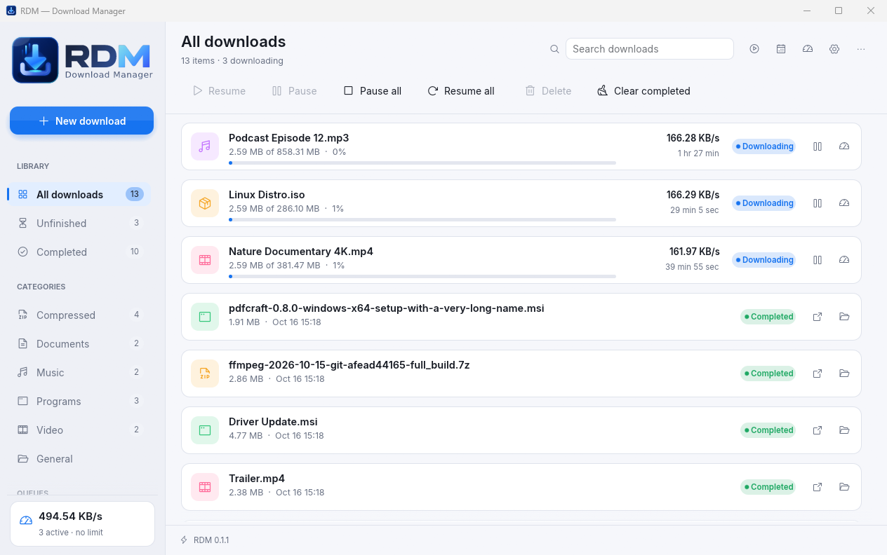
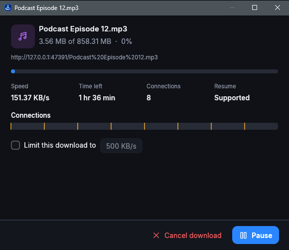
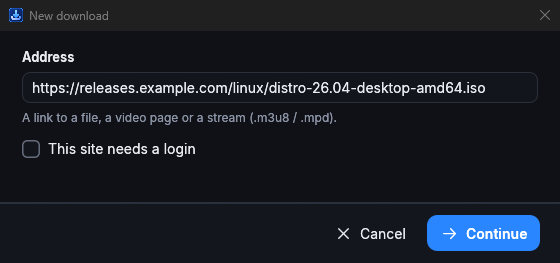
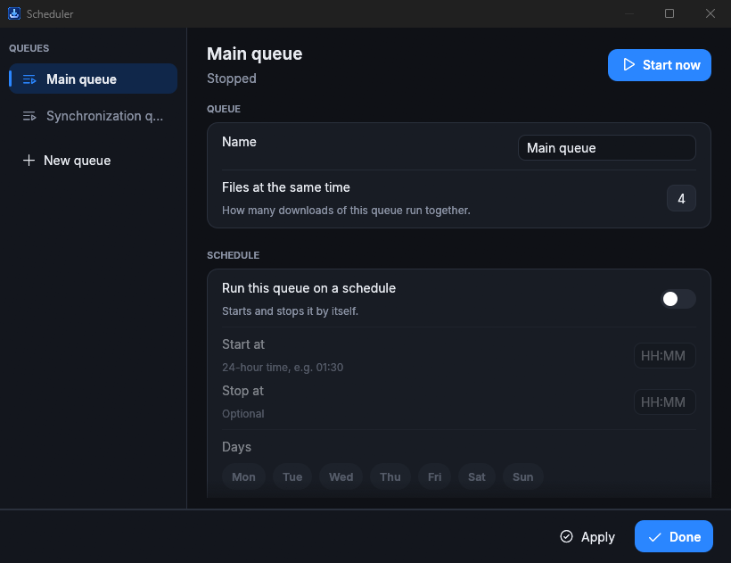
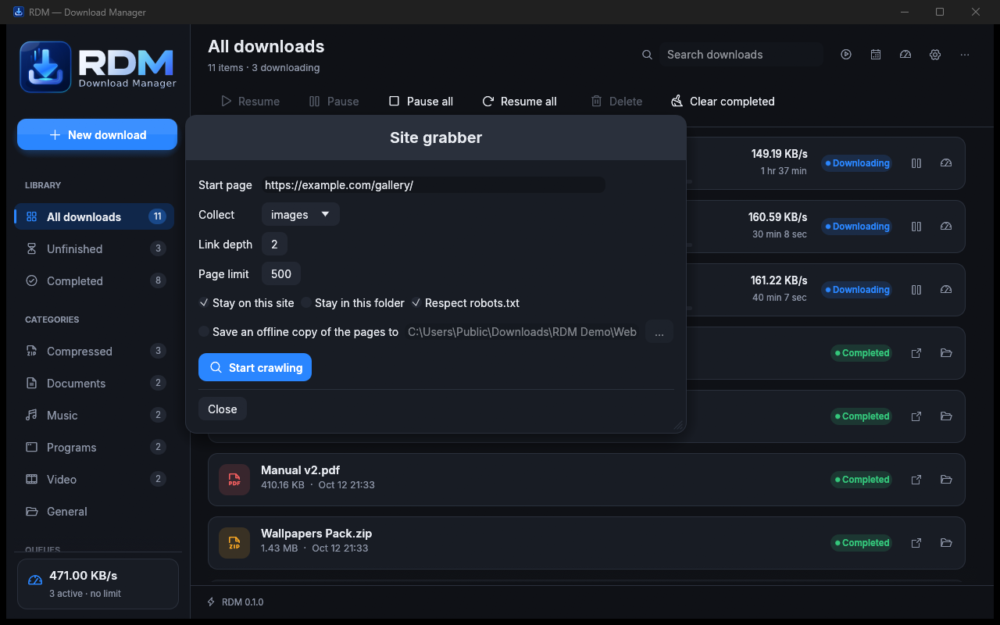
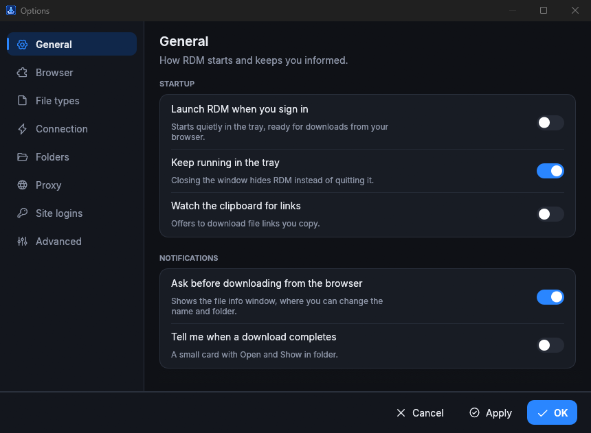
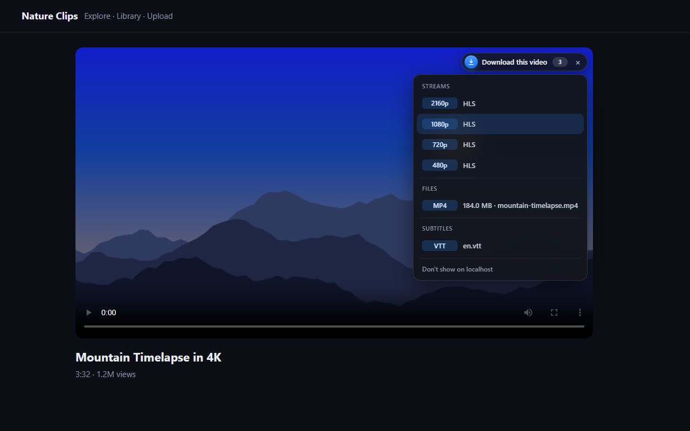
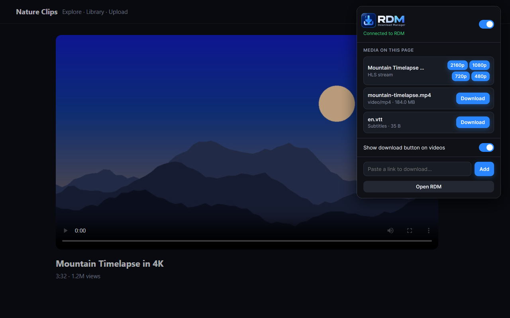

<p align="center">
  <picture>
    <source media="(prefers-color-scheme: light)" srcset="crates/rdm-gui/assets/rdm_logo_light.svg">
    
  </picture>
</p>

<p align="center">
  A fast, modern, cross-platform download manager written in Rust.<br>
  Multi-connection downloads, video and stream capture from any page, scheduler, site grabber and a browser extension.
</p>

<p align="center">
  <a href="https://github.com/rdm-dl/rdm/releases/latest"></a>
  <a href="https://github.com/rdm-dl/rdm/actions"></a>
  
  <a href="LICENSE"></a>
</p>

<p align="center">
  <a href="https://rdm-dl.github.io/">Website</a> ·
  <a href="https://github.com/rdm-dl/rdm/releases/latest">Download</a> ·
  <a href="#browser-extension">Browser extension</a> ·
  <a href="#build-from-source">Build from source</a>
</p>



## Features

### Download engine
- **Segmented multi-connection downloads** (8 connections by default) with dynamic splitting: a free connection always takes over half of the part with the most work left, so every socket stays busy until the end.
- Starts with 4 connections and doubles while every connection is receiving data. Adapts to servers that limit parallel connections.
- **Pause and resume at any time**, even after a crash or reboot (progress is saved every 2.5 s).
- Overlap checks between parts; falls back to a single connection if a server returns inconsistent data.
- HTTP, HTTPS and FTP; HTTP/SOCKS5 and system proxies; Basic authentication; saved logins per site; cookies and referrers from the browser.
- Smart file naming (Content-Disposition with UTF-8 names, `?file=` parameters). Never overwrites silently, and strips invisible characters that could disguise a file's real extension.
- The window stays responsive at all times: joining parts and merging audio/video run in the background with a progress bar.

### Video and streams
- **HLS** (`.m3u8`, including AES-128) and **MPEG-DASH** (`.mpd`): pick the quality, separate audio tracks included.
- **Built-in muxer**: video and audio are joined into one MP4 or WebM without ffmpeg (ffmpeg is used as a fallback for other combinations when it is installed).
- **YouTube**: all qualities up to 4K/8K and 60 fps, video and audio merged into one file. Signatures are handled by an embedded JavaScript engine; no external tools are needed.
- Subtitles (VTT/SRT) are listed next to the video.

### Organisation
- Categories (Compressed, Documents, Music, Programs, Video), each with its own folder.
- Queues with "N downloads at a time", a **scheduler** (start/stop times, weekdays, run once) and end-of-queue actions (exit, sleep, hibernate, shut down, hang up).
- Synchronization queue that downloads files again when the server copy changes.
- Global and per-download speed limits, plus download quotas ("at most X MB every N hours").
- **Site grabber**: crawl a website and collect images, videos, audio, documents, archives or your own file types, or save a complete **offline copy** with links rewritten for local browsing.
- Batch downloads from URL patterns (`file*.jpg`, 1–100, a–z) or from the clipboard; import and export lists.
- Clipboard monitoring, optional antivirus scan after completion, completion notifications.

### Integration
- Browser extension for **Chrome, Edge, Brave, Vivaldi, Opera and Firefox**.
- System tray icon, close to tray, start with the system, dark and light themes.
- `rdm` command-line tool and a headless daemon mode.

## Screenshots

| | |
|---|---|
|  |  |
| **Light theme** | **Download details: per-connection progress** |
|  |  |
| **New download** | **Scheduler and queues** |
|  |  |
| **Site grabber** | **Options** |
|  |  |
| **"Download this video" button on any player** | **Extension popup: media found on the page** |

## Install

Download the archive for your system from the [latest release](https://github.com/rdm-dl/rdm/releases/latest).

| System | File | Run |
|---|---|---|
| Windows 10/11 (x64) | `RDM-<version>-windows-x64.zip` | `rdm-gui.exe` |
| Linux (x64) | `RDM-<version>-linux-x64.tar.gz` | `rdm-gui` |
| macOS (Apple Silicon) | `RDM-<version>-macos-arm64.dmg` | `RDM.app` |
| macOS (Intel) | `RDM-<version>-macos-x64.dmg` | `RDM.app` |

- **Windows / Linux:** unpack it anywhere (for example `C:\Program Files\RDM`) and run the app.
- **macOS:** open the `.dmg` and drag **RDM** onto **Applications**. RDM isn't notarized by Apple yet, so the first time macOS will say it can't check the app: click **Done**, open **System Settings → Privacy & Security**, scroll down and click **Open Anyway** next to RDM. After that it opens normally.

## Browser extension

The extension sends downloads from the browser to RDM, adds a **Download this video** button to video players, lists the media found on each page and adds **Download with RDM** entries to the right-click menu.

**Easiest way:** in RDM open **Options → General → Install browser extension…**. The helper finds your browsers and walks you through each step: it connects RDM to the browser, opens the browser and copies the extensions page address for you, and shows the extension folder so you can drag it straight onto the browser.

Manual steps:

- **Chrome, Edge, Brave, Vivaldi, Opera**
  1. Open the extensions page (`chrome://extensions`, `edge://extensions`, `brave://extensions`, …).
  2. Turn on **Developer mode**.
  3. Click **Load unpacked** and select the `extension-chrome` folder from the RDM archive (or drag the folder onto the page).
- **Firefox**: open `about:addons` → gear menu → **Install Add-on From File…** and pick `rdm-firefox.xpi`.
- Then in RDM: **Options → General → Set up browser integration**.

Keyboard shortcuts while clicking a link: hold **Alt** to force a download through RDM, hold **Ctrl** to let the browser handle it.

## Command line

```
rdm get <URL> [-p folder] [-f name] [-c connections] [-l 500K] [--referer URL] [--cookie "a=b"] [-H "Name: value"]
rdm add <URL> [--now]       # send to the running app
rdm list                    # downloads in the running app
rdm show                    # bring the window to the front
rdm daemon                  # run without a window
```

`rdm get` resumes automatically when run again after an interruption (Ctrl+C pauses).

## Build from source

Requires Rust 1.85+ (edition 2024).

```
cargo build --release
python tools/package.py          # archive (.zip / .tar.gz / macOS .dmg) + extension in dist/
python tools/store_packages.py   # extension store packages in dist/store/
```

Linux needs: `libgtk-3-dev libxkbcommon-dev libwayland-dev libxrandr-dev libxi-dev libgl1-mesa-dev libxcb1-dev`.

Pushing a `v*` tag builds Windows, Linux and macOS archives with GitHub Actions and attaches them to a release.

| Path | Purpose |
|---|---|
| `crates/rdm-core` | Download engine, HLS/DASH, muxer, YouTube, manager (queues, scheduler, settings), site grabber, local IPC |
| `crates/rdm-gui` | Desktop app (egui) |
| `crates/rdm-cli` | `rdm` command-line tool |
| `crates/rdm-bridge` | Native-messaging host for the browser extension |
| `extension/` | Browser extension (Manifest V3, Chrome and Firefox manifests) |
| `docs/` | Website (GitHub Pages), screenshots, store submission guide |

## Privacy

RDM and its extension do not collect, store or send any data anywhere. The extension only talks to the RDM app on your own computer. See the [privacy policy](https://rdm-dl.github.io/privacy.html).

## License

MIT. The bundled Inter font is licensed under the SIL Open Font License (see `crates/rdm-gui/assets/fonts/Inter-LICENSE.txt`).
